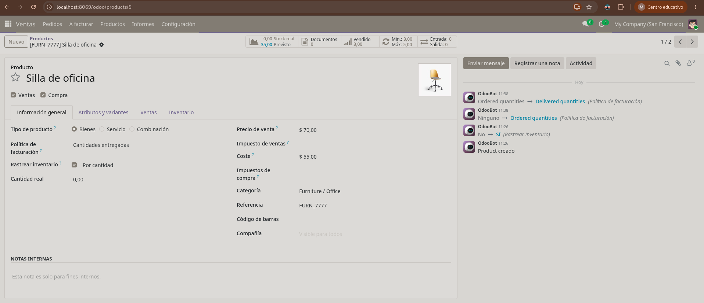
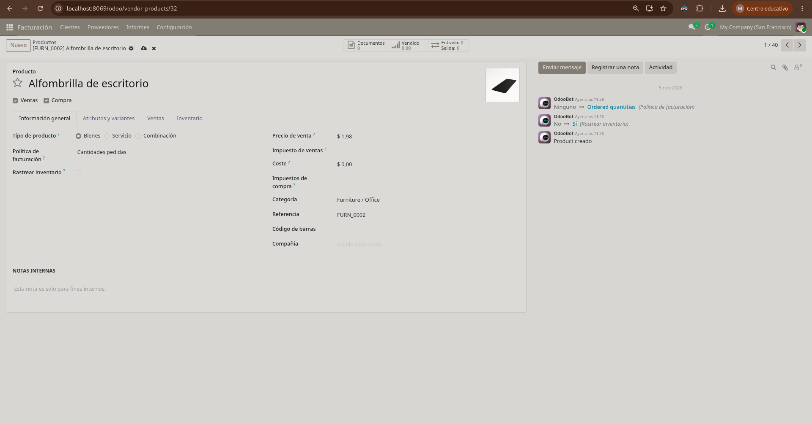

## Tarea09 - Implantación de Odoo

### Gestión de Bases de Datos

Creamos la base de datos real configurando el idioma en Español y el país en España, dejando desmarcados los datos de demostración:

Comprobamos en el gestor de Odoo que contamos con ambas bases de datos creadas (la de demostración y la real):

### Ejercicio 1:
1º Tipo:

2º Tipo:

3º Tipo:

4º Tipo:

### Ejercicio 2:

Diferencia entre contacto de tipo Compañía (Tech Vigo S.L.) e Individuo asociado (Laura Gómez):

Creamos el servicio "Hora de soporte" con sus valores correspondientes:

Creamos el bien "Libro tecnico" con sus valores correspondientes:

Confirmamos la factura mostrando el desglose de IVA (21 % y 4 %) en cada línea y descargamos su documento en PDF:

Planificamos una actividad de seguimiento en el chatter de la factura y registramos una factura de proveedor:

### Ejercicio 3:

Aplicamos un filtro en el listado de facturas para agruparlas por cliente y procedemos a guardar dicha configuración en el menú de Favoritos para un acceso rápido:

### Ejercicio 4:
El modo desarrollador se puede activar por dos vías diferentes:
1. Vía URL: Añadiendo el parámetro ?debug=1 justo después de /odoo en la barra de direcciones del navegador.
2. Vía interfaz: Entrando en el menú Ajustes, bajando hasta el final de la página y pulsando en Activar el modo desarrollador.

### Tabla de nombres técnicos inspeccionados

| Elemento en interfaz | Nombre técnico | Modelo de datos |
| :--- | :--- | :--- |
| Campo Correo electrónico | email | res.partner |
| Campo Teléfono | phone | res.partner |
| Documento Factura | account.move | account.move |

### Incidencias:

Error de permisos: Al crear productos saltaba restricción de acceso; se solucionó cambiando a la empresa española desde el selector superior derecho.

IVA incorrecto en ventas Se estaba operando con la empresa americana de la demo (15 %); al cambiar a la compañía española se aplicaron el 21 % y el 4 %. 