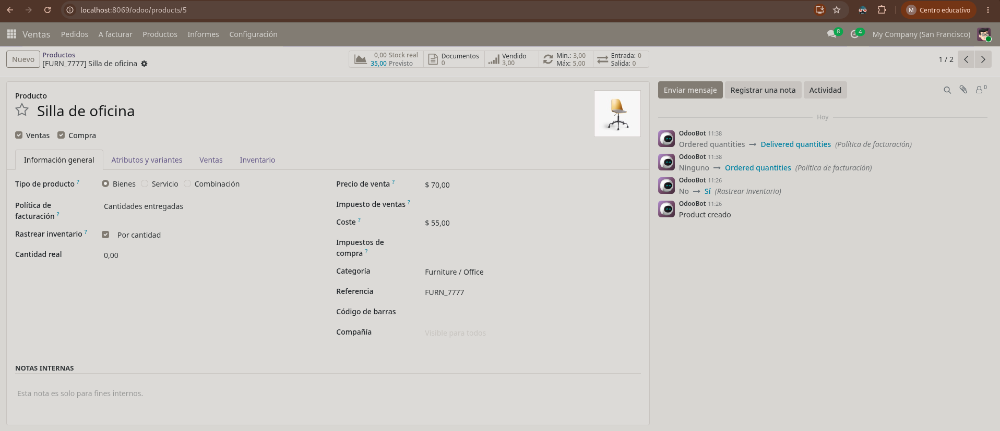
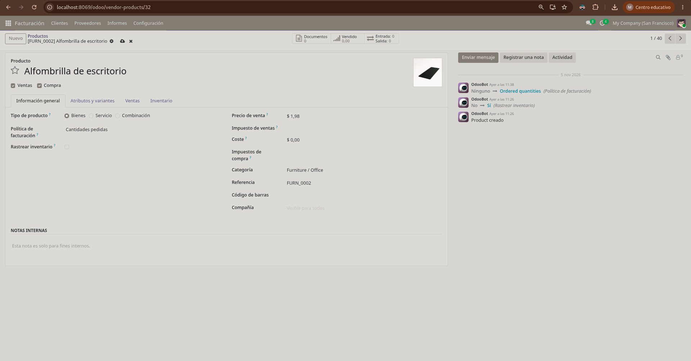
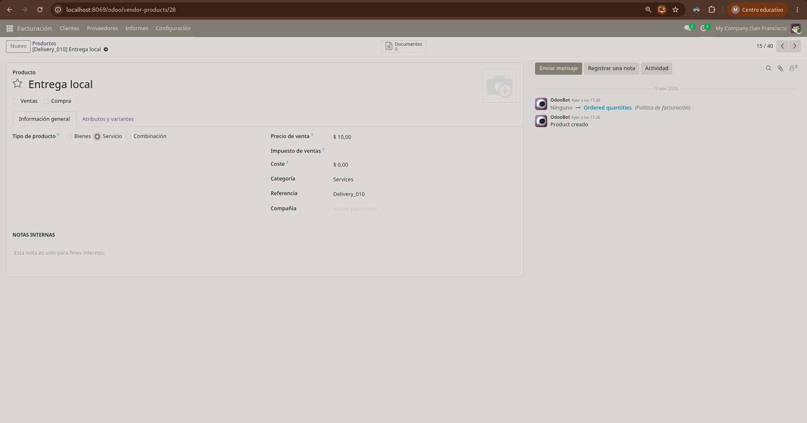
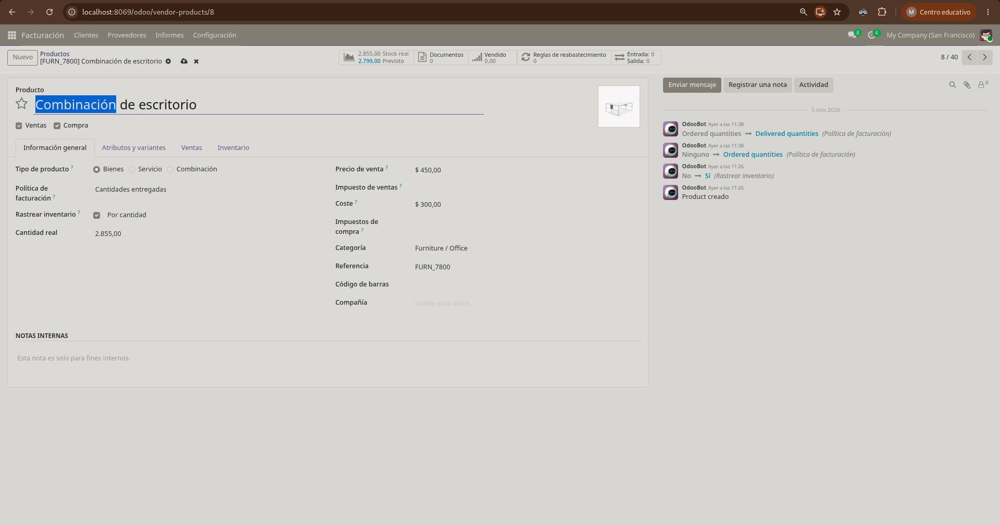
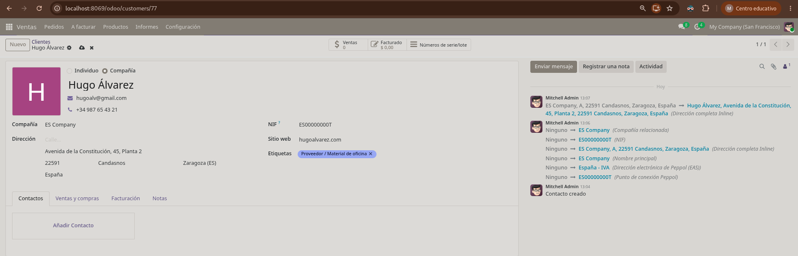
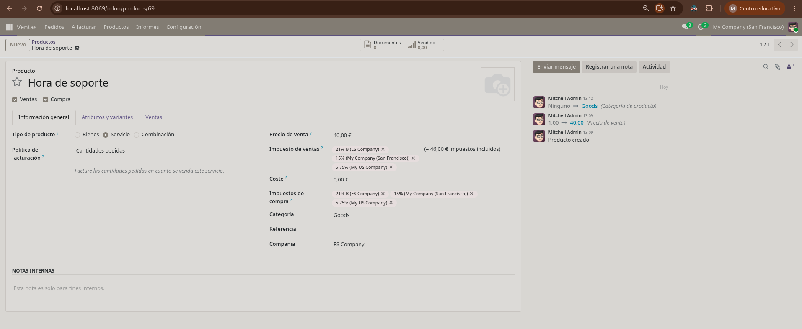
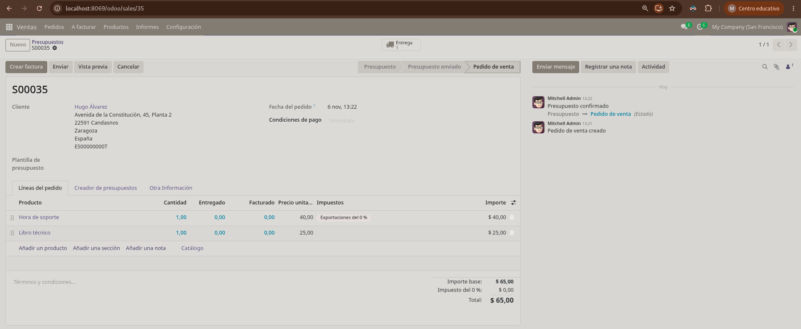
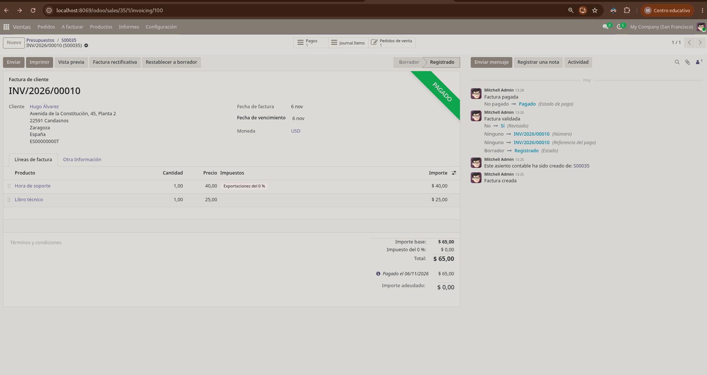
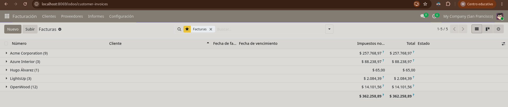
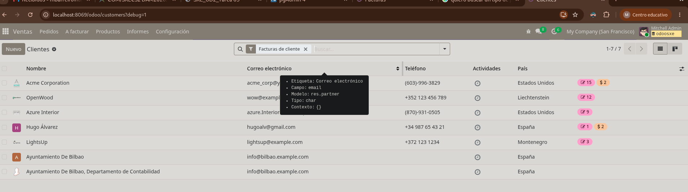

## Tarea09 - Implantación de Odoo

### Ejercicio 1:
1º Tipo: Bienes con Rastrear inventario:

2º Tipo: Bienes sin Rastrear inventario:

3º Tipo: Servicio

4º Tipo: Combinación

### Ejercicio 2:

Creación del cliente:

Creamos el servicio "Hora de soporte" con sus valores correspondientes:

Creamos el presupuesto y lo pasamos a pedido de venta:

Comprobamos la facturación con la etiqueta "Pagado":

### Ejercicio 3:

Aplicamos un filtro en el listado de facturas para agruparlas por cliente y procedemos a guardar dicha configuración en el menú de Favoritos para un acceso rápido:

### Ejercicio 4:
Tras activar el modo desarrollador mediante el parámetro "?debug=1" en la URL, se ha inspeccionado la vista de lista de contactos obteniendo la siguiente información técnica:

Declaración de IA: Usé gemini para encontrar cosas en el propio servicio de odoo, no era muy intuitivo y, por ejemplo, en el Ejercicio 1, la usé para que me indicara qué producto era el que coincidía con el tipo que buscaba.
