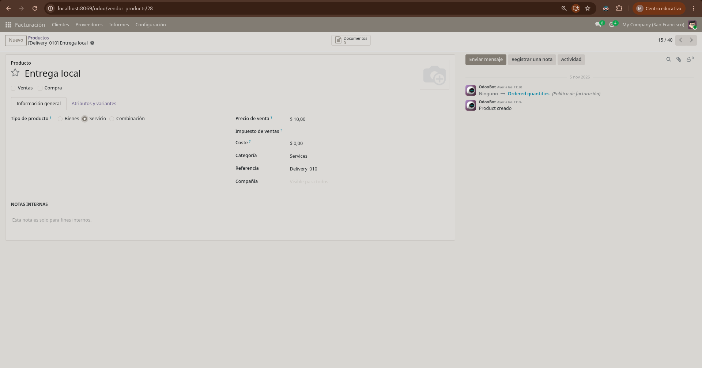
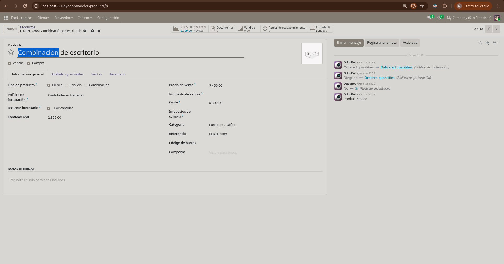
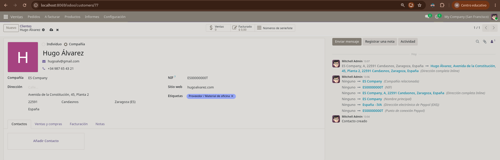
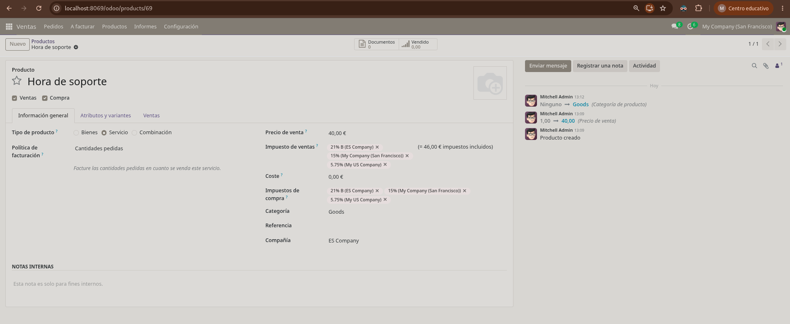
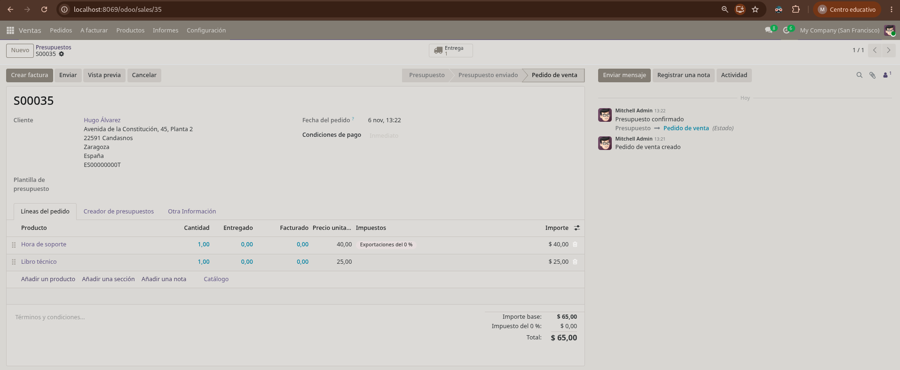
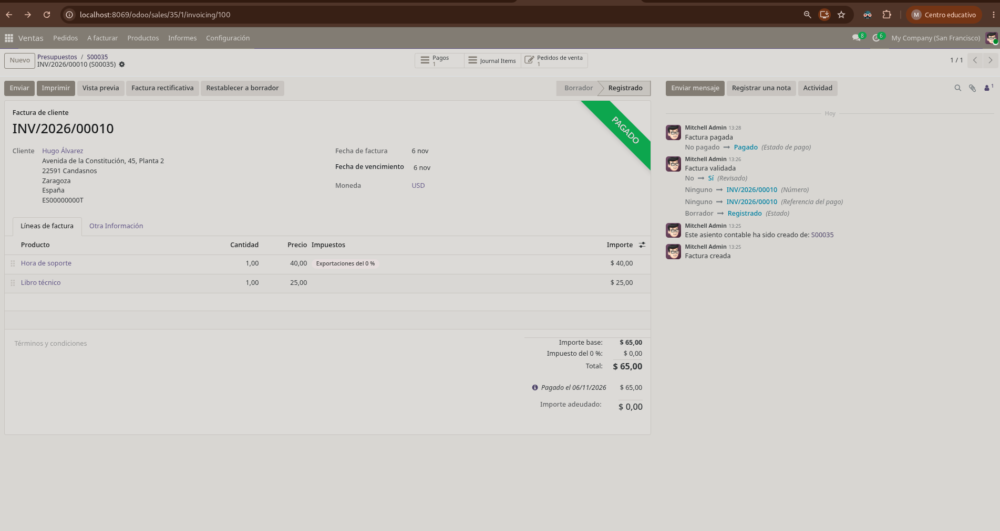
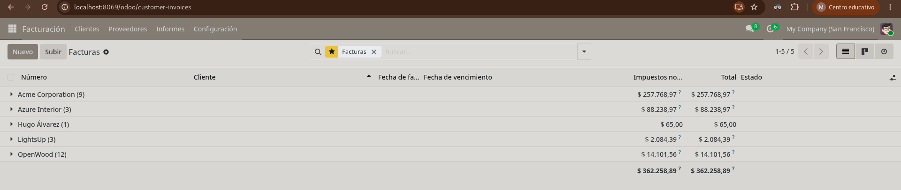
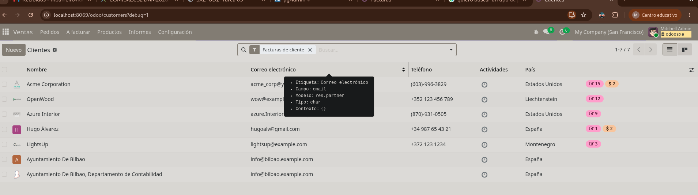

## Tarea09 - Implantación de Odoo

### Ejercicio 1:
1º Tipo:

2º Tipo:

3º Tipo:

4º Tipo:

### Ejercicio 2:

Creación del cliente:

Creamos el servicio "Hora de soporte" con sus valores correspondientes:

Creamos el presupuesto y lo pasamos a pedido de venta:

Comprobamos la facturación con la etiqueta "Pagado":

### Ejercicio 3:

Aplicamos un filtro en el listado de facturas para agruparlas por cliente y procedemos a guardar dicha configuración en el menú de Favoritos para un acceso rápido:

### Ejercicio 4:
Tras activar el modo desarrollador mediante el parámetro "?debug=1" en la URL, se ha inspeccionado la vista de lista de contactos obteniendo la siguiente información técnica:

### Incidencias:

Error de permisos: Al crear productos saltaba restricción de acceso; se solucionó cambiando a la empresa española desde el selector superior derecho.

IVA incorrecto en ventas Se estaba operando con la empresa americana de la demo (15 %); al cambiar a la compañía española se aplicaron el 21 % y el 4 %. |
| **Repositorio Git en carpeta raíz** | Se inicializó Git en `/home` cargando miles de archivos del sistema; se eliminó `.git` y se reinició únicamente dentro de la carpeta del proyecto. |
| **Búsquedas vacías en catálogo** | Los datos de demostración estaban en inglés; se localizaron los artículos usando sus nombres originales o limpiando los filtros por defecto. |